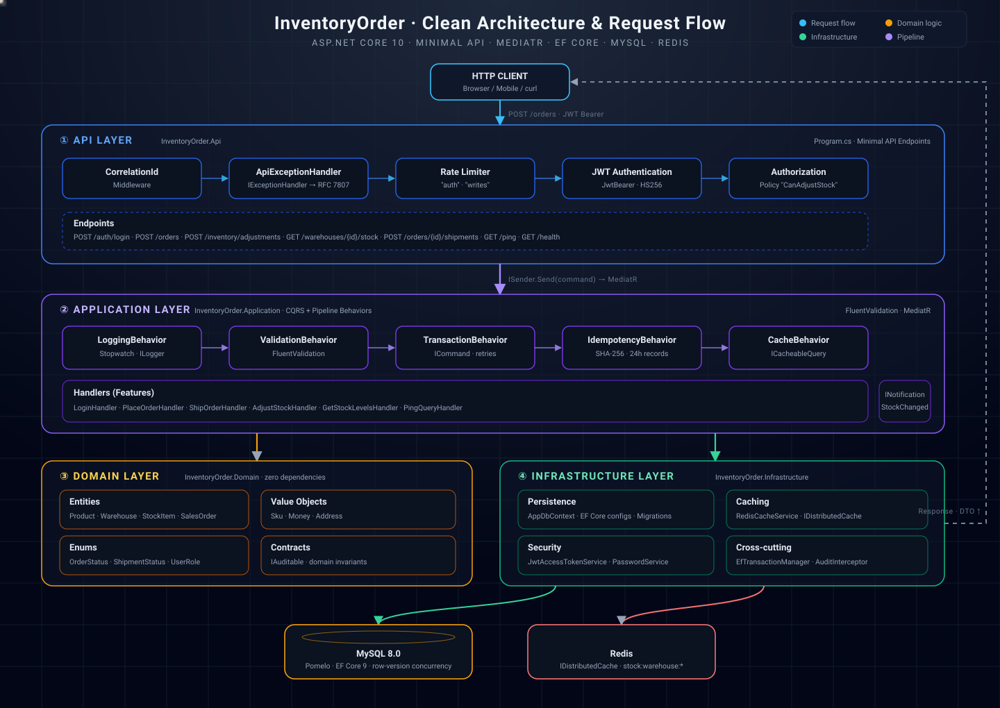

# Inventory & Order Backend

An ASP.NET Core inventory and order service built with Clean Architecture, CQRS, MediatR, EF Core, MySQL, Redis, JWT authentication, and optimistic concurrency.

## Architecture



```text
HTTP API
   ↓
MediatR pipeline: logging → validation → transaction → idempotency/cache
   ↓
Application features and domain behavior
   ↓
Infrastructure: EF Core/MySQL, Redis, JWT, audit history
```

The domain project has no EF Core or ASP.NET dependencies. Application defines ports such as `IApplicationDbContext`, `ICurrentUser`, and `ICacheService`; Infrastructure supplies their implementations.

## Run locally

```powershell
docker compose up -d
dotnet run --project InventoryOrder.Api
```

The API applies migrations and seeds development data when `Database:Seed` is enabled. The development users are:

- `admin` / `Admin123!`
- `manager` / `Manager123!`

Change the signing key and seeded passwords before using this outside local development.

## Main endpoints

| Method | Route | Access |
| --- | --- | --- |
| POST | `/auth/login` | Anonymous, rate limited |
| POST | `/orders` | Authenticated |
| POST | `/orders/{orderId}/shipments` | Authenticated |
| POST | `/inventory/adjustments` | Admin or warehouse manager |
| GET | `/warehouses/{warehouseId}/stock` | Authenticated |
| GET | `/health` | Development health check |

Use the returned bearer token in the `Authorization` header. Warehouse managers can adjust stock only for assigned warehouses; administrators have global warehouse access.

## Consistency and idempotency

Commands run inside an EF Core transaction. Stock has a binary concurrency token, and adjustment and shipment commands retry transient concurrency conflicts. Reservations increase `QuantityReserved`; shipping decreases both reserved and on-hand quantities.

Commands carrying an idempotency key store a request hash and serialized response for 24 hours. Retrying the same request returns the original response. Reusing a key with different input returns `409 Conflict`.

## Audit and caching

The DbContext records actor, timestamp, action, and serialized before/after values in `AuditLogs` for tracked business entities. It also fills created/updated audit fields automatically.

`GET /warehouses/{warehouseId}/stock` is cached in Redis for five minutes. Stock changes publish a notification that removes the warehouse cache entry.

## Observability and protection

- Structured Serilog console logs with `X-Correlation-ID`.
- OpenTelemetry ASP.NET Core and HTTP traces, exported through OTLP when configured.
- ProblemDetails responses from a centralized exception handler.
- Fixed-window limits on login and write endpoints.

## Tests and deployment

```powershell
dotnet test
```

The test suite covers domain invariants, EF mappings and concurrency, command workflows, authentication, warehouse scope, audit records, and cache behavior.

For a containerized stack, set `JWT_SIGNING_KEY` and run:

```powershell
docker compose -f docker-compose.prod.yml up --build -d
```

GitHub Actions restores dependencies, runs tests, builds the API, and validates the production image.
